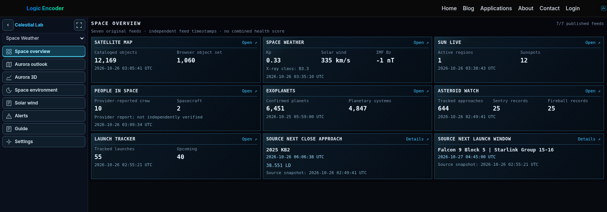
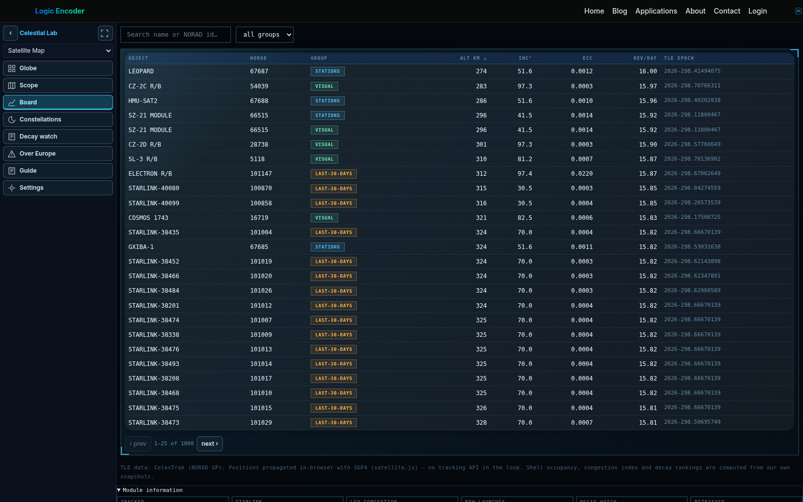
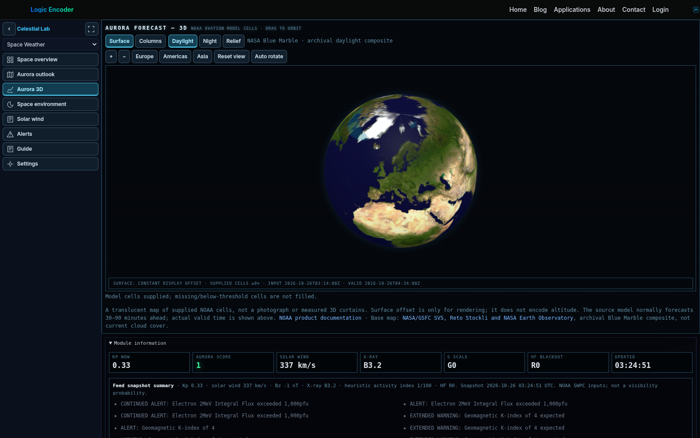
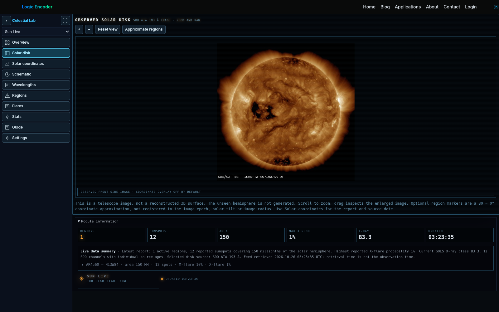
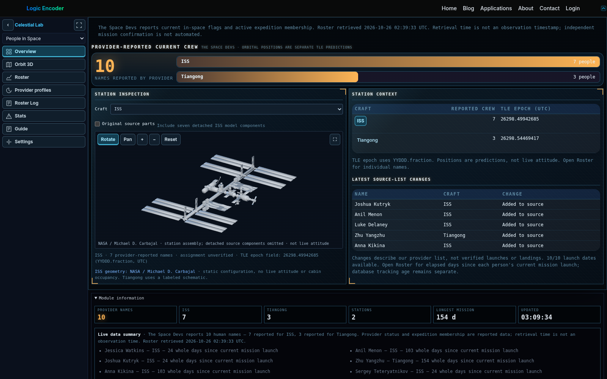
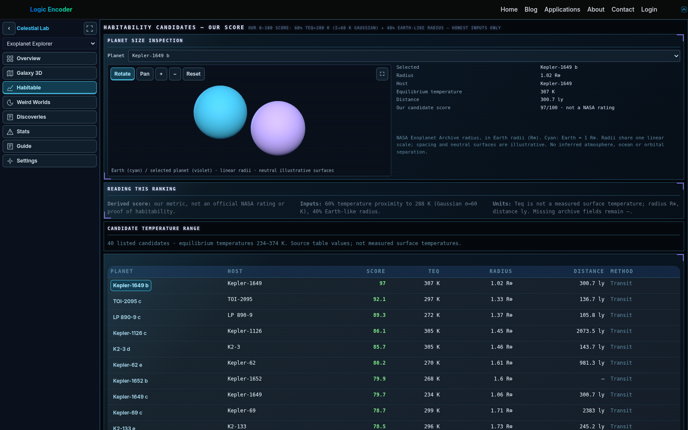
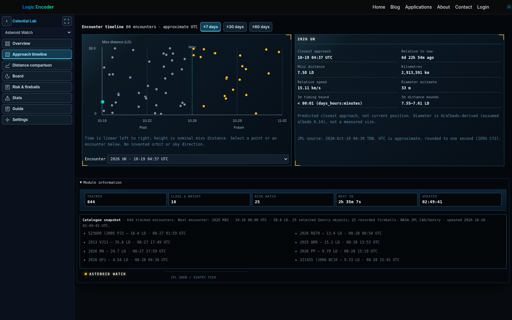
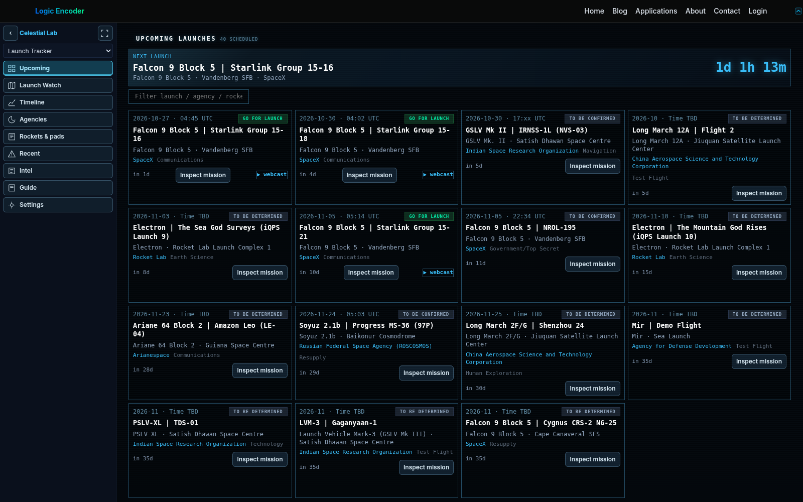

# Celestial Lab

Space information is spread across orbital catalogues, solar observations, mission schedules and astronomy archives. Celestial Lab brings seven related experiences into one workspace: start with a source-aware summary, then inspect the objects, observations or events behind it without switching applications.

Open [Celestial Lab](https://logicencoder.com/celestial-lab/).

## Tech stack

| Layer | Technologies |
|---|---|
| Application | WordPress, PHP, JavaScript, HTML, CSS |
| Interactive visualization | Three.js, Globe.gl, WebGL |
| Data collection | Python |

## A source-aware space overview

The opening board brings satellites, space weather, solar activity, provider-reported crew, exoplanets, asteroid encounters and launches together. Each area keeps its own publication time, so a recently retrieved weather feed does not make an older catalogue look newly observed. Direct links open the relevant detail, including the next encounter and launch window. There is no invented combined health score hiding those differences.

## Satellites: from orbital context to an object

Satellite Map lets users explore published orbital catalogues, filter orbital bands, follow ISS or Tiangong and add the separately loaded Starlink layer. Scope, Board, Constellations, Decay watch and Over Europe provide complementary ways to inspect objects and catalogue patterns rather than relying on a crowded globe alone. Selection exposes useful orbital context; zoom, reset and fullscreen support closer inspection.

The positions are predictions propagated from published orbital elements, not live measured coordinates. Being geometrically above the horizon does not establish optical visibility, and catalogue-derived congestion or decay indicators are not collision predictions.

## Space weather and aurora exploration

Aurora outlook, Space environment, Solar wind and Alerts help relate geomagnetic activity to the underlying measurements and messages. Aurora 3D offers Surface and Columns presentations and three Earth appearances—Daylight, Night and Relief—inside the same scene. Regional views, zoom, rotation and reset make it possible to inspect the supplied model cells without opening duplicate globes.

The aurora layer is NOAA model output, not a photograph, a measured curtain height or a guarantee that an observer will see an aurora. Its input and valid times remain visible. Earth base maps are archival backgrounds, not current cloud imagery; low or missing model cells are not filled with invented activity.

## Observe the Sun without confusing images and models

Sun Live combines an observed solar disk, selectable wavelengths, reported active regions, flares and statistics. Zoom and pan reveal detail in the telescope image. Solar coordinates and the schematic give complementary context for region reports rather than presenting the unseen hemisphere as a measured surface. Source dates and image context help distinguish a retrieved publication from the time it was observed.

## People in space and station context

People in Space separates the provider-reported roster, mission duration, station context and list history. Roster gives individual names and elapsed time since a known mission launch, rather than counting days since the application first stored a name. Orbit 3D adds predicted station positions; station inspection provides an interactive ISS model and a labeled Tiangong schematic.

Provider reports are not independently confirmed mission assignments. List additions and removals describe source-list changes, not verified launches or landings. Station geometry is illustrative and does not show live attitude or cabin occupancy.

## Explore exoplanet catalogues at several scales

Exoplanet Explorer brings catalogue browsing, Galaxy 3D, Habitable candidates, Weird Worlds, Discoveries and statistics into one area. Distance displays distinguish physical scaling from an explicitly expanded nearby scale. The Habitable view pairs its candidate table with one interactive size comparison against Earth, keeping the inspection where it is relevant instead of repeating it throughout the application.

The candidate score is the application's own temperature-and-radius metric, not an official NASA rating or evidence of life. Equilibrium temperature is not a measured surface temperature. Neutral planet surfaces illustrate relative size; they do not invent observed oceans or atmospheres. Missing archive fields remain visibly missing.

## Understand asteroid encounters and different risk records

Asteroid Watch provides an encounter timeline, distance comparisons, a searchable board, risk and fireball information, and statistics. Select an encounter to inspect its published closest-approach time, miss distance and relative velocity. The timeline uses time and distance rather than fabricated sky directions, making the axes meaningful when comparing events.

Close approaches, Sentry monitoring records and recorded fireballs are different datasets. A close approach is not an impact prediction. Where size is inferred from brightness and assumed reflectivity, the estimate is identified rather than presented as a direct measurement.

## Follow launch schedules with their uncertainty intact

Launch Tracker includes upcoming missions, Launch Watch, a timeline, agencies, rockets and pads, recent missions and broader launch intelligence. Filter the schedule, inspect mission details and follow available webcast links. A known next launch can have a countdown while tentative schedules retain their published uncertainty.

Confirmed clock times, day-only dates and estimated month or quarter windows are not interchangeable. The application preserves that distinction so an imprecise source date does not become a misleading exact event.

## One consistent workspace

A collapsible left rail keeps module and view navigation available. Shared controls distinguish selected, hover, keyboard-focus and disabled states. Fullscreen and display preferences adapt the experience to the current task; long lists remain reachable through ordinary page scrolling. Guides explain specialised terms alongside the data.

Publications depend on external sources and may be delayed or unavailable. Celestial Lab is an exploratory information application, not an operational warning service. Check the named source and its timestamp before relying on an observation or forecast.

---

Private implementation: [celestial-lab-plugin](https://github.com/logicencoder/celestial-lab-plugin). Related repositories: [REPOS.md](REPOS.md).

**[Logic Encoder](https://logicencoder.com)** · [GitHub](https://github.com/logicencoder) · [Contact](https://logicencoder.com/contact/)
